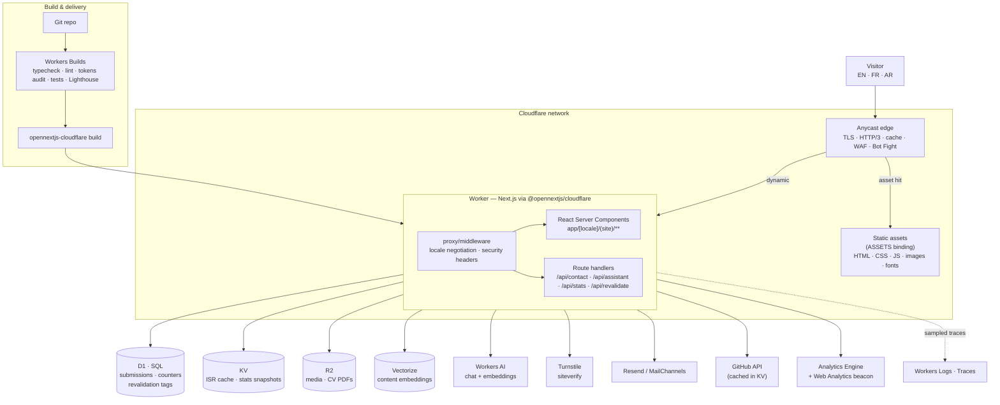

# Architecture

A personal portfolio for a software/IT professional that is also a working
demonstration of engineering quality. Everything below is written to be *read
by a technical visitor*: the site's own architecture is a selling point, so the
implementation is deliberately strict where strictness pays off (types,
contrast, budgets) and boring where invention would cost reliability.

## 1. Goals and non-negotiables

| Goal | How it is enforced |
| --- | --- |
| Convert visitors into clients/employers | Single-page narrative with deep-linkable sections, service→brief form hand-off, availability badge, localized CV |
| Prove engineering quality | Strict TypeScript, Zod at every boundary, machine-checked design tokens, CI-gated Lighthouse/a11y budgets |
| Serve EN / FR / AR (RTL) natively | `next-intl` routing, logical CSS properties everywhere, Arabic typeface with tuned leading, mirrored motion |
| Be fast on a mid-range phone | Worker-rendered HTML from the edge, <250 ms TTFB target, LCP <2 s, CLS <0.05, route-level code splitting |
| Never flash, never jank | Pre-hydration theme script, token-driven motion, GSAP/R3F capability-gated and off the critical path |
| Stay cheap to operate | Static assets + ISR caches on Cloudflare; D1/KV/R2/Vectorize all inside the free-to-low tiers; no always-on server |

## 2. System architecture



Three consequences of this shape, and why they matter:

1. **Static first.** Every route that can be prerendered is; only the assistant,
   contact form, stats and revalidation endpoints execute application code. The
   expensive parts of a portfolio are *readers*, not writers, so we pay for
   rendering rarely and serve from cache the rest of the time.
2. **One runtime.** The Next.js server, the middleware and the API handlers all
   run in the same Worker via the OpenNext adapter, so there is no second
   platform to secure, monitor or pay for. Bindings (D1/KV/R2/Vectorize/AI) are
   injected by the platform rather than fetched over the network with credentials
   in the environment.
3. **Content is data.** `src/content/**` is typed TS (+ MDX for long-form), so a
   new project, note or service is a data change: no component edits, no
   hard-coded copy, and the same data feeds the i18n messages, the sitemap, the
   structured data and the assistant's retrieval index.

## 3. Request lifecycle

**a. Prerendered page (the common case)**
`GET /fr/projects/edge-observability` → edge cache hit for the asset/manifest →
the Worker checks the KV-backed incremental cache (wrapped in a per-data-centre
Cache API layer) → returns HTML with the locale's `<html lang dir>` already
correct, `hreflang` alternates, JSON-LD and hashed CSS/JS. No database access,
no AI, no third-party call.

**b. First render / revalidation**
Cache miss → React Server Components render in the Worker → content resolved
from `src/content` (bundled, no I/O) → HTML stored in KV → `revalidateTag`
bookkeeping written to D1. Publishing a note or editing a case study triggers
`POST /api/revalidate` (secret-protected), which invalidates exactly that tag.

**c. Locale negotiation (middleware)**
No locale prefix → parse `Accept-Language` (fall back to geo → default `en`) →
302 to `/{locale}{path}` preserving the path and hash anchor → set the
`NEXT_LOCALE` cookie so the choice sticks. A switch from an explicit locale
writes the cookie and rewrites in place, so the *current section* is preserved
rather than bouncing to the home page.

**d. Contact brief (write path)**
`POST /api/contact` → Turnstile `siteverify` → Cloudflare rate-limit binding
(5/min per key) → Zod parse of the multi-step payload → D1 insert → email via
Resend/MailChannels → `202` with a human-readable, localized result. Failures
are always reported; the client never shows a false "sent".

**e. Assistant (streaming)**
`POST /api/assistant` → rate limit (20/min) → embed the question with a
multilingual model → Vectorize top-k over the owner's content → Workers AI chat
completion streamed as SSE → the browser renders tokens as they arrive with the
source chips that were retrieved. Out-of-scope questions are refused by prompt
contract, and answers are constrained to retrieved context.

**f. Live developer stats**
`GET /api/stats` → KV snapshot hit (15 min TTL) → otherwise fetch GitHub (and
optionally WakaTime), normalise, cache, return. Upstream failure is never
surfaced as a broken widget: the section falls back to the last snapshot, then
to the fixture data committed in `src/content`.

## 4. Rendering and caching matrix

| Route | Strategy | Cache | Invalidation |
| --- | --- | --- | --- |
| `/{locale}` (home) | Static (SSG) + client islands | Edge + KV incremental | `revalidateTag('home')` on content change |
| `/{locale}/projects` | Static, filter state in URL | Edge | tag `projects` |
| `/{locale}/projects/[slug]` | ISR, 1 h + on-demand | KV incremental + regional | tag `project:<slug>` |
| `/{locale}/notes/[slug]` | ISR (MDX rendered at build) | KV incremental | tag `note:<slug>` |
| `/{locale}/services/[slug]` | Static | Edge | tag `services` |
| `/{locale}/cv` | Static per locale (generated PDF in R2) | R2 + edge | tag `cv:<locale>` |
| `/api/contact` | Dynamic, `no-store` | none | — |
| `/api/assistant` | Dynamic, streaming, `no-store` | none (retrieval cached in KV by question hash) | — |
| `/api/stats` | Dynamic, 15 min KV snapshot | KV | TTL + manual refresh |
| `/api/revalidate` | Dynamic, secret-protected | none | writes tags in D1 |
| `/sitemap.xml`, `/rss.xml`, `/{locale}/opengraph-image` | Generated at request time from content | Edge (1 h) | content hash in path/query |

Cache keys are locale-scoped by construction (locale is a path segment), so
switching language can never serve a stale translation.

## 5. Data layer

| Store | Holds | Why this store |
| --- | --- | --- |
| **D1** | `briefs`, `brief_events`, `assistant_logs`, `page_views`, `work_likes`, OpenNext revalidation tags | Relational, low write volume, SQL reports ("which service did leads ask for?"), free tier is plenty |
| **KV** | OpenNext incremental cache, stats snapshots, assistant retrieval cache | Edge-replicated reads, TTL semantics, no consistency requirement |
| **R2** | Case-study screenshots/video posters, localized CV PDFs, OG image cache | Cheap object storage served through the CDN; keeps binaries out of the build |
| **Vectorize** | One vector per content chunk (`profile`, `experience`, `projects`, `services`, `notes`), metadata: `locale`, `kind`, `slug`, `title` | Multilingual embeddings let an Arabic question retrieve an English case study |
| **Analytics Engine + Web Analytics** | Aggregate funnels (brief started/sent, assistant opened) | Privacy-friendly, aggregate-only, no cookie banner |

D1 schema (migrations in `migrations/`, applied with `npm run cf:d1:migrate`):

```sql
briefs(id, created_at, locale, name, email, company, service, budget, timeline,
       message, source, ip_hash, user_agent, status, referrer)
brief_events(id, brief_id, kind, created_at)          -- funnel + spam forensics
assistant_logs(id, created_at, locale, question_hash, topic, answered, latency_ms)
page_views(slug, locale, day, views, PRIMARY KEY(slug, locale, day))
work_likes(slug, day, likes, PRIMARY KEY(slug, day))
```

Privacy rules baked into the schema: no raw IPs (`ip_hash` = salted SHA-256),
no message bodies in analytics, assistant questions stored only as hashes plus a
coarse topic label, and a documented retention window in the deployment guide.

## 6. Security posture

- **Every boundary is validated.** Zod schemas in `src/lib/validation/` are the
  single source for form validation *and* the API handlers; the client imports
  the same schema it is checked against server-side. No `any`, no unchecked
  `await request.json()`.
- **Turnstile** on the brief form (and on the assistant entry point if abuse
  appears) with hostname + action verification, not just token presence.
- **Rate limiting** through the native Cloudflare `ratelimits` binding
  (`CONTACT_RATE_LIMIT`, `ASSISTANT_RATE_LIMIT`, `STATS_RATE_LIMIT`), keyed on
  salted IP hash + route, with a D1 sliding-window check as defence in depth.
- **Headers** set in middleware for every document response: strict CSP (nonce
  per request, `strict-dynamic` only where unavoidable), `X-Content-Type-Options`,
  `Referrer-Policy: strict-origin-when-cross-origin`, `Permissions-Policy`
  denying camera/mic/geolocation, HSTS, and `frame-ancestors 'none'`.
- **Secrets never reach the client.** Only `NEXT_PUBLIC_*` values are bundled;
  everything else is a Worker secret read from `CloudflareEnv` at request time.
- **Prompt-injection containment.** Retrieved content is treated as data, never
  as instructions, and the assistant's system contract refuses anything outside
  the owner's professional scope — including attempts to extract the prompt.
- **No destructive endpoints.** The only write endpoints are the brief form and
  a secret-protected revalidation hook; both are idempotent or additive.

## 7. i18n and RTL architecture

**Routing.** `/{locale}/…` with `en` (LTR), `fr` (LTR), `ar` (RTL). `next-intl`
owns negotiation, the `NEXT_LOCALE` cookie, localized pathnames and the typed
message API. Every route declares `generateStaticParams()` for the three
locales, so all locales share one build.

**Copy.** Zero hard-coded strings: `messages/{en,fr,ar}.json` hold UI copy,
`src/content/**` holds personal/professional data per locale, and MDX holds
long-form case studies. Missing Arabic keys fail the typecheck (typed message
keys) rather than silently rendering English.

**Direction.** The shell sets `dir` from the locale; components use logical
properties only (`ms-`/`me-`/`ps-`/`pe-`, `inset-inline-*`, `start`/`end`), and
`--dir-sign` flips motion (carousels, arrows, progress bars) without JS
branches. `overflow: clip` + `min-inline-size: 0` keep mirrored layouts from
owning a horizontal scrollbar.

**Arabic specifics.** `--font-arabic` (IBM Plex Sans Arabic) replaces both the
display and text faces via `:lang(ar)`, with `--tracking-*` zeroed (letter
spacing breaks glyph joining) and `--leading-*` raised for the taller script.
Latin islands — code, URLs, version numbers, stack names — are wrapped in
`dir="ltr"` + `unicode-bidi: isolate` so mixed runs never reorder.
Arabic-Indic numerals (`١٢٣`) are a formatting choice, not a CSS one: a toggle
persisted with the theme switches `Intl.NumberFormat` between `ar` and
`ar-u-nu-arab`, and dates use `Intl.DateTimeFormat` with `calendar`/`numberingSystem`
declared per locale.

**Discoverability.** `hreflang` alternates (including `x-default`) on every
page, localized `<title>`/description/OG images, and a language switcher that
preserves the current page *and* anchor.

## 8. Motion architecture

One vocabulary in `src/styles/tokens.css` (`--dur-*`, `--ease-*`, `--stagger-*`,
`--distance-*`, `--motion-scale`), mirrored 1:1 in `src/lib/motion/` so CSS and
JavaScript timelines cannot drift:

```
lib/motion/tokens.ts    → typed mirror of the CSS custom properties
lib/motion/variants.ts  → reveal, stagger, drawer, page, shared-element
lib/motion/timelines.ts → GSAP ScrollTrigger registrations (storytelling)
lib/motion/capability.ts→ tier detection: full | reduced | minimal
lib/motion/useMagnetic.ts, useCountUp.ts, usePointerField.ts
```

Rules: animation never causes layout shift (transform/opacity only, or
`grid-template-rows` on a measured wrapper); heavy work pauses off-screen
(`IntersectionObserver`) and on tab blur; 3D/particles are lazy-loaded and only
for tier `full`; `prefers-reduced-motion` collapses the token vocabulary itself,
which switches Framer Motion (`MotionConfig reducedMotion="user"`), GSAP
(`matchMedia`) and CSS at the same instant. Page transitions use
`AnimatePresence` for in-app navigation and the View Transitions API for the
theme change, with a class-based cross-fade fallback.

## 9. Theming

`data-theme="light|dark"` on `<html>` holds the *resolved* theme;
`data-theme-mode="system|light|dark"` holds the *preference*. A blocking inline
script in `<head>` resolves and applies both before first paint, so there is no
flash and no hydration mismatch (the client provider adopts, never re-applies).
System mode follows `matchMedia` live. A `?theme=` query and the command palette
can also set the preference; the choice persists in `localStorage` and is
reflected in `color-scheme` so form controls, scrollbars and native UI match.

Tokens are consumed through a Tailwind v4 bridge (`@theme inline`), so utilities
like `bg-surface` / `text-fg-muted` resolve to the *variable*, not a frozen
value — theme switching is a single attribute flip, never a second class set.

## 10. Layering and import boundaries

```
content (data)  ←  lib (pure logic)  ←  components (presentation)  ←  app (routes)
                                        ↑
                                   server/* (Workers bindings)
```

- `src/content/**` imports nothing but types — it is data, and it is what the
  owner edits.
- `src/lib/**` is pure (no React, no bindings) except for the explicitly
  client-side hooks, so it is unit-testable in isolation.
- `src/components/**` may import content and lib, never `src/server/**`, never a
  route, and may not read `process.env` (config arrives as props).
- `src/server/**` is the only place that touches `getCloudflareContext()` /
  bindings, and it is imported exclusively by route handlers and server
  components.
- `app/api/**` is thin: parse → validate → rate-limit → delegate → respond.
  Business logic lives in `src/server/**` and `src/lib/**`.
- Enforced by ESLint `import/no-restricted-paths` (configured in Part 2), so a
  violation fails `npm run lint` rather than review.

## 11. Folder tree

```
.
├─ docs/                        ARCHITECTURE.md · DESIGN-SYSTEM.md · DEPLOYMENT.md ·
│                               CONTENT-GUIDE.md · ACCESSIBILITY.md
├─ messages/                    en.json · fr.json · ar.json (UI copy, typed keys)
├─ migrations/                  D1 migrations (0001_init.sql, …)
├─ public/                      images/ · icons/ · favicon, manifest assets
├─ scripts/                     audit-contrast.mjs · build-og-assets · seed-vectorize
├─ src/
│  ├─ app/
│  │  ├─ [locale]/
│  │  │  ├─ (site)/             home · projects/[slug] · notes/[slug] · services/[slug] ·
│  │  │  │                      cv · legal/…  + layout.tsx (shell, fonts, providers)
│  │  │  └─ opengraph-image.tsx localized OG generation
│  │  ├─ api/                   contact · assistant · stats · revalidate
│  │  ├─ sitemap.ts · robots.ts · rss.xml/route.ts · globals.css
│  ├─ components/
│  │  ├─ layout/                header, mobile-nav, footer, language-switcher, theme-toggle
│  │  ├─ sections/              hero, about, skills, experience, projects, services,
│  │  │                         process, architecture, testimonials, notes, contact
│  │  ├─ ui/                    Button, Card, Badge, Dialog, Tabs, Tooltip, Field, …
│  │  ├─ motion/                Reveal, Stagger, MagneticButton, SplitHeadline,
│  │  │                         ScrollProgress, PageTransition
│  │  ├─ diagrams/              StackMap, ArchitectureFlow, TimelineRail, Mermaid
│  │  ├─ assistant/             AssistantLauncher, AssistantPanel, SourceChips
│  │  └─ palette/               CommandPalette, TerminalEasterEgg
│  ├─ content/                  profile · experience · projects · services · testimonials ·
│  │  │                         process · skills · stats · site (all typed, per locale)
│  │  └─ notes/                 MDX notes (en/fr/ar)
│  ├─ lib/
│  │  ├─ i18n/                  routing · request · navigation · format (Intl)
│  │  ├─ motion/                tokens · variants · timelines · capability · hooks
│  │  ├─ theme/                 script · provider · transitions · storage
│  │  ├─ seo/                   metadata · jsonld · og · hreflang
│  │  ├─ stats/                 github · wakatime · snapshots
│  │  ├─ ai/                    prompt · retrieval · chunking · guardrails
│  │  ├─ validation/            contact-schema · assistant-schema · shared
│  │  └─ utils/                 cn · dates · reading-time · slugify
│  ├─ server/
│  │  ├─ d1/                    client · briefs · counters · tag-cache tables
│  │  ├─ kv/                    cache · stats-store · retrieval-cache
│  │  ├─ mail/                  resend · mailchannels · templates
│  │  ├─ turnstile/             siteverify · types
│  │  └─ rate-limit/            binding · sliding-window · keys
│  ├─ styles/                   tokens.css (design system) · fonts.ts · globals.css
│  └─ tests/                    unit/ · components/ · fixtures/
├─ tests/                       e2e/ (Playwright flows) · visual/ (LTR+RTL snapshots)
├─ next.config.ts · open-next.config.ts · wrangler.jsonc
└─ tsconfig.json · package.json · .env.example
```

Why `src/tests/` *and* `tests/`: Vitest specs live beside the source they cover
(path aliases and `@/…` imports just work), while Playwright specs are a
repo-level concern with their own config, browser matrix and snapshot folders.

## 12. Quality gates

| Gate | Target | Command |
| --- | --- | --- |
| Types | 0 errors, no `any`, no suppressions | `npm run typecheck` |
| Lint | 0 errors incl. import-boundary rules | `npm run lint` |
| Design tokens | 74 WCAG pairs pass, light/dark parity, no-JS fallback equality | `npm run audit:contrast` |
| Unit/component | validation, formatting, RTL helpers, motion tokens | `npm run test` |
| E2E | language switch, theme toggle, palette, brief submit, assistant | `npm run test:e2e` |
| Visual | home/projects/notes × {en,ar} × {light,dark} × {mobile,desktop} | `npm run test:e2e -- --project=visual` |
| Accessibility | axe: 0 critical/serious on every route, both dirs and themes | part of E2E |
| Performance | Lighthouse mobile ≥95 across the four categories | Workers Builds job |

Budget targets that CI enforces: LCP < 2 s (mobile, 4× CPU), CLS < 0.05,
INP < 200 ms, JS shipped on the home route < 180 KB gzipped (assistant, 3D scene
and palette are dynamic imports and do not count against first load), fonts
self-hosted and subset with `font-display: swap`.

## 13. Decision log

**D1 — Next.js 15.5 on OpenNext, not Next 16.** `@opennextjs/cloudflare@1.20.9`
accepts `next >=15.5.27 <16 || >=16.3.8`. Next 16 moves the request boundary to
`proxy.ts`, which runs on the Node.js runtime, and the adapter's own support
matrix still lists Node.js middleware as unsupported. Locale negotiation must
live at the edge, so we stay on the 15.5 line where `middleware.ts` on the edge
runtime is fully supported. Revisit when the adapter ships Node middleware.

**D2 — Tailwind v4 with tokens as CSS variables.** The spec requires tokens as
variables for RTL/theme work; Tailwind v4's CSS-first `@theme inline` bridge
gives utilities that *reference* the variables, so a theme change is one
attribute instead of a second utility set, and there is no JS theme object to
keep in sync.

**D3 — KV incremental cache + D1 tag cache + `queue: "direct"`.** The
adapter's defaults cache nothing beyond prerendered HTML. KV keeps ISR bodies
cheap and edge-local, D1 keeps `revalidateTag` bookkeeping durable, and inline
revalidation avoids operating a Durable Object or a queue product for a site
with a handful of routes. Durable-Object sharded tag cache and the DO queue stay
documented as the upgrade path for traffic spikes.

**D4 — Design tokens are machine-checked.** Contrast, parity and fallback
invariants are asserted by `scripts/audit-contrast.mjs` (no dependency on a
browser or a design tool). Fixing the palette instead of relaxing the check is
enforced by CI, which is what keeps "accessible in both themes" true after the
owner edits tokens.

**D5 — `--border-interactive` is separate from `--border`.** Decorative
hairlines are exempt from WCAG 1.4.11, control boundaries are not. Splitting the
tokens lets the editorial look stay delicate while inputs, outline buttons and
tabs are guaranteed ≥3:1.

**D6 — Radix UI primitives via the `radix-ui` package.** Dialog, Tabs, Tooltip
and Popover need correct focus management, `aria-*` wiring and RTL behaviour;
re-implementing that is where accessible design systems usually fail. Radix is
unstyled, so the design system still owns every pixel.

**D7 — Assistant retrieval is multilingual by design.** One Vectorize index with
multilingual embeddings (`bge-m3`) rather than per-locale indexes: a French
visitor asking about a German-language project still gets the English case
study, and the answer is generated in the visitor's language from retrieved
facts.

**D8 — View Transitions API for theme and page changes, with fallbacks.**
Theme switching is decorative motion; where the API is missing we cross-fade a
class, and under `prefers-reduced-motion` we do nothing at all.

## 14. Build order

| Part | Deliverable | Notable artifacts |
| --- | --- | --- |
| 1 | Architecture, design tokens, tree, `wrangler.jsonc` | this file, `DESIGN-SYSTEM.md`, `tokens.css`, `audit-contrast.mjs`, `open-next.config.ts` |
| 2 | i18n + RTL + theme (no flash) + shell & navigation | `messages/*.json`, `lib/i18n`, `lib/theme`, `components/layout`, `globals.css` bridge, ESLint boundaries |
| 3 | Hero, About, Skills stack map | `sections/hero|about|skills`, `diagrams/StackMap`, motion primitives |
| 4 | Experience timeline, projects grid, case-study template | `sections/experience|projects`, `diagrams/Mermaid`, `content/projects` |
| 5 | Services, Process, Testimonials | `sections/services|process|testimonials`, carousel with swipe/keyboard |
| 6 | Live Architecture section, command palette, terminal egg | `sections/architecture`, `palette/*`, real build info |
| 7 | Brief form + Workers backend | `migrations/`, `server/*`, `/api/contact`, Turnstile, rate limits |
| 8 | AI assistant (RAG, multilingual, streaming) | `lib/ai`, `/api/assistant`, `scripts/seed-vectorize` |
| 9 | SEO, OG, sitemap, RSS, PWA, perf pass, tests | `lib/seo`, `app/opengraph-image`, `tests/*`, Lighthouse budget |
| 10 | Deployment + content guide | `docs/DEPLOYMENT.md`, `docs/CONTENT-GUIDE.md`, `docs/ACCESSIBILITY.md` |

Part 2 completes the pieces Part 1 deliberately left to it: `next.config.ts`
(with the intl plugin and `initOpenNextCloudflareForDev()`), the Tailwind
`@theme inline` bridge, ESLint/Prettier configs, and the verified wiring of the
caching overrides in `open-next.config.ts` once dependencies are installed.
